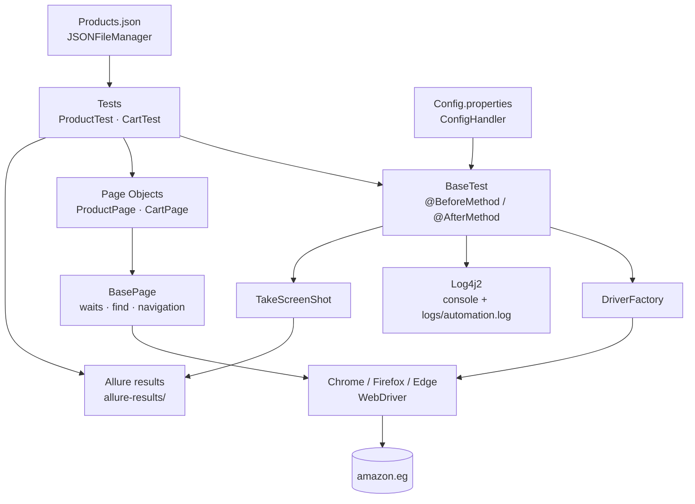

# 🛒 Amazon Egypt – UI Test Automation Framework

> End-to-end UI test automation for [amazon.eg](https://www.amazon.eg/) built with **Java, Selenium WebDriver, TestNG and Maven**, using the **Page Object Model**, config/data-driven execution, **Log4j2** logging and **Allure** reporting with screenshots on failure.


 <!-- TODO: add license (e.g. MIT) and update this badge -->

---

## 📑 Table of Contents

1. [Overview](#-overview)
2. [Quick Start](#-quick-start)
3. [Demo Video](#-demo-video)
4. [Key Features](#-key-features)
5. [Tech Stack](#-tech-stack)
6. [Project Structure](#-project-structure)
7. [Framework Architecture](#-framework-architecture)
8. [Test Scenarios](#-test-scenarios)
9. [Prerequisites](#-prerequisites)
10. [Setup & Configuration](#-setup--configuration)
11. [How to Run](#-how-to-run)
12. [Reporting (Allure)](#-reporting-allure)
13. [Logging](#-logging)
14. [Design Decisions & Best Practices](#-design-decisions--best-practices)
15. [Known Limitations & Roadmap](#-known-limitations--roadmap)
16. [Troubleshooting](#-troubleshooting)
17. [Author](#-author)
18. [License](#-license)

---

## 📌 Overview

This project automates core shopping journeys on **Amazon Egypt**: searching, filtering, sorting, product-detail validation, adding items to the cart and updating cart quantities.

**Approach**

- Each test runs in a **fresh browser session** (incognito) that opens the URL from `Config.properties`.
- UI logic lives in **Page Objects**; tests only describe the scenario using fluent method chaining.
- Search terms and price limits come from **`Products.json`**, the browser and base URL from **`Config.properties`**.
- Every run produces **Allure results** (with a screenshot attached to failed tests) and a **rolling log file**.

---

## ⚡ Quick Start

```bash
git clone https://github.com/<your-username>/Amazon_Ahmed_Amr.git   # TODO: replace with the real repo URL
cd Amazon_Ahmed_Amr
# (optional) edit src/main/resources/Config.properties -> browser = chrome | firefox | edge
mvn clean test
allure serve allure-results
```

> ⚠️ **Important:** `pom.xml` points Surefire to `testng.xml`, but the suite file in the repo is **`testNg.xml`**. This works on Windows (case-insensitive) but fails on Linux/macOS. See [How to Run](#-how-to-run) for the one-line fix.

---

## 🎬 Demo Video

A short recording of the test suite running on Amazon Egypt:

https://github.com/user-attachments/assets/REPLACE-WITH-YOUR-VIDEO-ID

---

## ✨ Key Features

| Feature | Details |
|---|---|
| **Page Object Model** | `BasePage` → `ProductPage` / `CartPage`; locators are `private final` inside the pages |
| **Fluent API** | Page methods return `this`, so tests read like the user journey |
| **Factory pattern** | `DriverFactory` creates/quits Chrome, Firefox or Edge based on `Config.properties` |
| **Cross-browser** | `chrome`, `firefox`, `edge` (drivers resolved automatically by Selenium Manager) |
| **Config-driven** | Browser and base URL in `Config.properties` (`ConfigHandler`) |
| **Data-driven** | Search terms and price limits in `Products.json` (`JSONFileManager`, Gson) |
| **Explicit waits** | 30-second `WebDriverWait` wrappers in `BasePage`; no `Thread.sleep` |
| **Soft assertions** | `SoftAssert` used for multi-element product-detail checks |
| **Logging** | Log4j2 → console + rolling file `logs/automation.log` |
| **Reporting** | Allure results; screenshot attached automatically when a test fails |

---

## 🧰 Tech Stack

| Tool | Version | Purpose |
|---|---|---|
| Java | 26 (`java.version` in `pom.xml`) | Programming language |
| Maven | – | Build & dependency management |
| Selenium WebDriver | 4.48.0 | Browser automation (includes Selenium Manager) |
| TestNG | 7.12.0 | Test runner, annotations, assertions |
| Allure TestNG | 2.35.5 | Reporting adapter |
| Log4j2 (core + api) | 2.26.1 | Logging |
| Gson | 2.14.0 | Reading `Products.json` |
| Apache POI / POI-OOXML | 5.5.1 | Excel utilities *(declared in `pom.xml`, not yet used by tests)* |
| OpenCSV / Commons CSV | 5.12.0 / 1.14.1 | CSV utilities *(declared in `pom.xml`, not yet used by tests)* |
| maven-surefire-plugin | 3.5.3 | Runs the TestNG suite |
| maven-compiler-plugin | 3.14.0 | Compiles with the configured Java version |

---

## 🗂 Project Structure

```text
Amazon_Ahmed_Amr
├── pom.xml                              # Dependencies, plugin versions, Surefire suite config
├── testNg.xml                           # TestNG suite: ProductTest + CartTest
├── logs/                                # Runtime log output (git-ignored)
├── allure-results/                      # Raw Allure results created after a run
└── src
    ├── main
    │   ├── java/pages
    │   │   ├── basePage/BasePage.java       # Shared waits, find helpers, navigation
    │   │   ├── productPage/ProductPage.java # Search, filters, sorting, product details, add to cart
    │   │   └── cartPage/CartPage.java       # Cart actions, quantity update, price/subtotal checks
    │   └── resources
    │       ├── Config.properties            # browser + url
    │       ├── Products.json                # Search terms and price limits
    │       └── log4j2.properties            # Console + rolling file logging config
    └── test/java
        ├── baseTest/BaseTest.java           # @BeforeMethod setup, @AfterMethod screenshot + teardown
        ├── productTest/ProductTest.java     # Product search/filter/details/free-shipping tests
        ├── cartTest/CartTest.java           # Cart tests
        ├── driverFactory
        │   ├── DriverFactory.java           # Picks the driver from the browser name
        │   ├── GetChromeDriver.java         # Chrome (incognito) singleton
        │   ├── GetFireFoxDriver.java        # Firefox singleton
        │   └── GetEdgeDriver.java           # Edge (incognito) singleton
        └── utilities
            ├── ConfigHandler.java           # Reads .properties files
            ├── JSONFileManager.java         # Reads JSON into a LinkedHashMap
            └── TakeScreenShot.java          # Captures a screenshot as a File
```

---

## 🏗 Framework Architecture



**Execution flow per test:** `@BeforeMethod` loads config + data → creates the browser via `DriverFactory` → opens the URL and maximizes the window → the test runs page-object steps → `@AfterMethod` attaches a screenshot on failure and quits the browser.

---

## 🧪 Test Scenarios

All tests open `https://www.amazon.eg/` in a new browser session before they start.

| ID | Class | Test | What it verifies |
|---|---|---|---|
| PT-01 | `ProductTest` | `BrowseAndFilterProducts` | Searches `product1` (`laptop`), applies the **Dell** brand filter, sets max price to **21100** with the price slider, sorts **Low to High**, then runs `verifyMatchingSelectedFilters` and `verifySortingOrderCurrently`. ⚠️ Both verification methods only print/inspect values — there is **no assertion**, so this test fails only on an exception or timeout. |
| PT-02 | `ProductTest` | `searchValidationInvalidInput` | Searches the special-character string `product2` (`@#$%^&*`), opens the 1st result and reads its category, goes back, opens the 2nd result and reads its category. **Assert:** the two categories are **not equal** (`assertNotEquals`). |
| PT-03 | `ProductTest` | `productDetailsVerification` | Searches `product3` (`shoes men`), opens the first in-stock result. **SoftAssert** that title, price, availability, image, rating section and Add-to-Cart button are all displayed. |
| PT-04 | `ProductTest` | `AddMultipleProductsFreeShipping` | Searches `shoes men`, applies **Free Shipping**, sets max price to `price1` (2050), sorts **High to Low**, adds **3** products, lowers max price to `price2` (340), adds **1** more. **Asserts:** side cart contains **4** items, and the subtotal is **> 6175 and ≤ 6500**. |
| CT-01 | `CartTest` | `AddMultipleProductsToCart` | Searches `product4` (`Wireless mouse`), adds the 1st result to the cart, goes back twice, adds the 2nd result, opens the cart. **Assert:** the cart badge shows **2**. |
| CT-02 | `CartTest` | `UpdateCartQuantity` | Searches `laptop`, adds the 1st result, opens the cart, **increments** quantity twice. **Asserts:** counter = `3` and subtotal = unit price × 3; then **decrements** twice and asserts subtotal = unit price. |

---

## ✅ Prerequisites

| Requirement | Notes |
|---|---|
| **JDK 26** | Version set in `pom.xml` (`java.version`). The code uses `List.getFirst()`, so JDK 21+ is the technical minimum if you lower the property. |
| **Maven 3.9+** | Or use the IntelliJ bundled Maven |
| **Browser** | Google Chrome (default), Firefox or Microsoft Edge |
| **Internet access** | Tests hit the live `amazon.eg` site; Selenium Manager also downloads the matching driver on first run |
| **Allure CLI** *(optional)* | Needed only to view the report |

---

## ⚙️ Setup & Configuration

**1. Clone and open**

```bash
git clone https://github.com/<your-username>/Amazon_Ahmed_Amr.git   # TODO: replace with the real repo URL
cd Amazon_Ahmed_Amr
```

**2. Choose browser and URL** – `src/main/resources/Config.properties`

```properties
url = https://www.amazon.eg/
browser = chrome        # chrome | firefox | edge
```

**3. Adjust test data** – `src/main/resources/Products.json`

```json
{
  "product1": "laptop",
  "product2": "@#$%^&*",
  "product3": "shoes men",
  "product4": "Wireless mouse",
  "price1": "2050",
  "price2": "340"
}
```

> Config and data files are read with **relative paths**, so always run the tests from the project root.

---

## ▶️ How to Run

### Fix the suite file name first (Linux/macOS/CI)

In `pom.xml` the Surefire plugin references `testng.xml`, while the file is named `testNg.xml`. Make them match:

```xml
<configuration>
    <suiteXmlFiles>testNg.xml</suiteXmlFiles>
</configuration>
```

### Commands

| Goal | Command |
|---|---|
| Run the whole suite (`testNg.xml`) | `mvn clean test` |
| Run one class | `mvn clean test -Dtest=CartTest` |
| Run one method | `mvn clean test -Dtest=CartTest#UpdateCartQuantity` |

<!-- TODO: verify that -Dtest overrides <suiteXmlFiles> in this setup; if the full suite still runs, use IntelliJ or a parameterised suite file. -->

### From IntelliJ IDEA

- **Whole suite:** right-click `testNg.xml` → **Run**.
- **One class / method:** open the test class, click the green ▶ next to the class or the `@Test` method.
- Make sure the working directory is the **project root** (default for Maven projects).

---

## 📊 Reporting (Allure)

Allure writes raw results to **`allure-results/`** during the run. On a failed test, `BaseTest` captures a screenshot and attaches it to the report as **“Screenshot”**.

**Install the Allure CLI** (one option per OS):

```bash
# Windows (Scoop)
scoop install allure
# macOS (Homebrew)
brew install allure
# Any OS with Node.js
npm install -g allure-commandline
```

**View the report**

```bash
# Generate + open in a temporary local server
allure serve allure-results

# Or generate a static report, then open it
allure generate allure-results --clean -o allure-report
allure open allure-report
```

| Artifact | Location |
|---|---|
| Allure raw results | `allure-results/` |
| Generated HTML report | `allure-report/` |
| Failure screenshots | Captured to the OS temp folder, then attached to the Allure result (see *Known Limitations*) |
| Logs | `logs/automation.log` |

<!-- TODO: add a screenshot of the Allure report here, e.g.  -->

---

## 📝 Logging

Configured in `src/main/resources/log4j2.properties`:

| Setting | Value |
|---|---|
| Root level | `INFO` |
| Appenders | Console + RollingFile |
| Log file | `logs/automation.log` |
| Rolling | Daily **and** at 10 MB; keeps max 10 archives (`automation-<date>-<n>.log.gz`) |
| Pattern | `%d{yyyy-MM-dd HH:mm:ss.SSS} %-5level [%t] %c{1.} - %msg%n` |
| Config reload | Every 30 seconds (`monitorInterval`) |

**Sample output**

```text
2026-10-18 21:34:23.545 INFO  [main] b.BaseTest - Starting setup
2026-10-18 21:34:23.607 INFO  [main] b.BaseTest - Initializing browser: chrome
2026-10-18 20:33:27.249 INFO  [main] u.TakeScreenShot - Starting takeScreenShot
```

> Currently `BaseTest` and `TakeScreenShot` use the Log4j2 logger. Page objects still use `System.out.println` in a few places (see roadmap).

---

## 🎯 Design Decisions & Best Practices

- **Separation of concerns** – tests describe *what*, page objects implement *how*.
- **Private locators** – every `By` is `private final` inside its page class.
- **Explicit waits only** – `WebDriverWait` (30 s) wrappers in `BasePage`; no hard sleeps.
- **Synchronisation on UI state** – after slider/add-to-cart/quantity actions the code waits for the result count, subtotal or cart counter to change.
- **Reusable lifecycle** – `BaseTest` owns driver setup, screenshot-on-failure and teardown.
- **Browser abstraction** – `DriverFactory` hides browser-specific setup; adding a browser means one new class and one `case`.
- **Externalised data** – URL, browser and test data are not hard-coded in test methods (except the price ranges listed below).
- **Soft assertions** where several independent checks belong to one scenario (`productDetailsVerification`).
- **Precise money handling** – `BigDecimal` is used for unit price × quantity in `CartPage`.

---

## 🚧 Known Limitations & Roadmap

### Known limitations (honest review of the current code)

| # | Area | Issue |
|---|---|---|
| 1 | **Suite config** | `pom.xml` references `testng.xml`, file is `testNg.xml` → breaks on case-sensitive systems |
| 2 | **Assertions** | `BrowseAndFilterProducts` has no assertion; `verifyMatchingSelectedFilters` and `verifySortingOrderCurrently` only print |
| 3 | **Filter check** | `verifyMatchingSelectedFilters` looks for `"HP"` in titles while the applied filter is **Dell** |
| 4 | **Sorting check** | `verifySortingOrderCurrently` calls `allPrice.get(i - 1)` when a violation is found, which throws `IndexOutOfBoundsException` if it happens at index 0 |
| 5 | **Teardown order** | `BaseTest` has two `@AfterMethod` methods; TestNG does not guarantee their order, so the browser could be closed before the screenshot is taken |
| 6 | **Parallelism** | Drivers are `static` singletons → tests cannot run in parallel |
| 7 | **Firefox option** | `--incognito` is a Chrome/Edge flag; Firefox uses private mode via a different argument (verify) |
| 8 | **Hard-coded values** | `21100`, `6175–6500`, item counts and the free-shipping filter id are in code |
| 9 | **Locale-dependent locators** | Several locators depend on English UI text (`Low`, `High to`, `left in stock`, `results for`) and Amazon's CSS class names |
| 10 | **Logging** | Page objects use `System.out.println`; `ConfigHandler` / `JSONFileManager` use `printStackTrace()` and don't close their streams |
| 11 | **Screenshots** | Saved to the OS temp directory and only reachable through the Allure attachment |
| 12 | **Unused dependencies** | POI, OpenCSV, Commons CSV are declared but not used yet |
| 13 | **Live site** | Tests depend on live data (prices, stock, filters) and may hit Amazon's anti-bot checks |
| 14 | **CI & repo hygiene** | No CI pipeline; `allure-results/` is not in `.gitignore` |

### Roadmap

- [ ] Fix the Surefire suite file name; parameterise it (`-DsuiteXmlFile=...`)
- [ ] Add real assertions to PT-01 and fail on sorting/filter violations
- [ ] Merge the two `@AfterMethod` methods (screenshot first, then quit)
- [ ] Replace `System.out.println` with Log4j2 loggers across page objects
- [ ] **GitHub Actions** pipeline: run tests + publish the Allure report to GitHub Pages
- [ ] **Parallel execution** with `ThreadLocal<WebDriver>`
- [ ] **Retry analyzer** (`IRetryAnalyzer`) for flaky UI steps
- [ ] **Headless mode** switch via config
- [ ] **Docker / Selenium Grid** execution
- [ ] Data-driven tests from **Excel/CSV** using the already included POI/OpenCSV
- [ ] Allure annotations (`@Epic`, `@Feature`, `@Story`, `@Step`) for richer reports

---

## 🛠 Troubleshooting

<details>
<summary><b>Surefire: “No tests were executed” / suite file not found</b></summary>

The suite file name must match exactly. Use `testNg.xml` in `pom.xml` (see [How to Run](#-how-to-run)).
</details>

<details>
<summary><b>Browser/driver version mismatch or driver not found</b></summary>

Selenium Manager downloads the matching driver automatically; it needs internet access on the first run. Update your browser, or check proxy/firewall settings if the download is blocked.
</details>

<details>
<summary><b>TimeoutException / NoSuchElementException on Amazon pages</b></summary>

Amazon changes its markup and runs A/B experiments. Re-inspect the failing locator in the page class and update it. Also check that the site is shown in **English**, because some locators match English text.
</details>

<details>
<summary><b>Captcha or “Sorry, something went wrong” page</b></summary>

Amazon may flag automated traffic. Wait and retry, avoid running many sessions in a row, or use a different network.
</details>

<details>
<summary><b>Unsupported class file major version / release version not supported</b></summary>

The project targets **Java 26**. Install JDK 26 and set it as the project SDK in IntelliJ, or lower `java.version` in `pom.xml` (JDK 21+ is needed for `getFirst()`).
</details>

<details>
<summary><b>Config.properties / Products.json not found (FileNotFoundException)</b></summary>

Paths are relative to the working directory. Run Maven from the project root and make sure IntelliJ's working directory is the project root.
</details>

<details>
<summary><b>`allure` command not found</b></summary>

Install the Allure CLI (see [Reporting](#-reporting-allure)) and reopen your terminal.
</details>

---

## 👤 Author

**Ahmed Amr** <!-- TODO: confirm full name -->

- LinkedIn: <!-- TODO: add LinkedIn URL -->
- GitHub: <!-- TODO: add GitHub profile URL -->
- Email: <!-- TODO: add email -->

---

## 📄 License

<!-- TODO: choose a license (e.g. MIT), add a LICENSE file, and mention it here. -->
